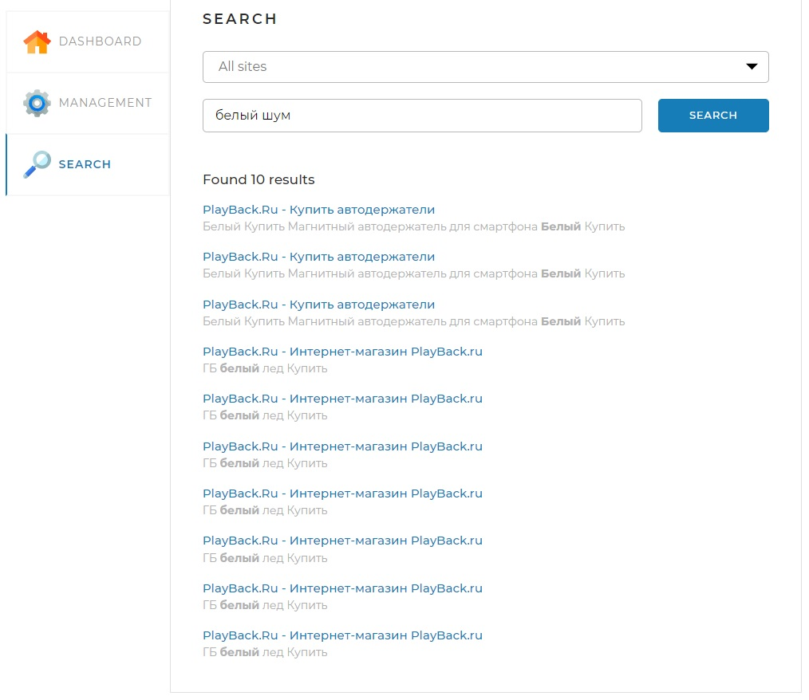

# Search Engine
Дипломный проект курса Java - разработки Skillbox. Поисковый движок с индексацией сайтов, морфологическим разбором (русский язык) и полнотекстовым поиском.

Проект индексирует страницы указанных сайтов, строит индекс на основе лемм (с поддержкой русской морфологии) и позволяет искать по ним через REST API и веб-интерфейс.

## Возможности

- Индексация нескольких сайтов (настраивается в конфигурации)
- Полная переиндексация и остановка индексации
- Индексация отдельной страницы по URL
- Полнотекстовый поиск с учётом русской морфологии (Lucene Morphology)
- Статистика по сайтам, страницам и леммам
- Простой веб-интерфейс

## Технологии

- Java 17
- Spring Boot 3
- Spring Data JPA
- MySQL
- Jsoup (парсинг HTML)
- Apache Lucene Morphology (лемматизация)
- Thymeleaf (веб-интерфейс)
- Maven

## Требования

- JDK 17+
- Maven 3.8+
- MySQL 8.x

## Быстрый старт

### 1. База данных

Создайте базу данных:

```sql
CREATE DATABASE search_engine CHARACTER SET utf8mb4
```
### 2. Конфигурация
Скопируйте пример конфигурации и отредактируйте под себя:
```bash
cp src/main/resources/application.yaml.example src/main/resources/application.yaml
```
Основные параметры в application.yaml:
```yaml
spring:
  datasource:
    url: jdbc:mysql://localhost:3306/search_engine?useSSL=false&allowPublicKeyRetrieval=true
    username: root
    password: your_password

indexing-settings:
  userAgent: "Mozilla/5.0 ..."
  referrer: "https://www.google.com"
  sites:
    - url: https://lenta.ru
      name: Лента.ру
    - url: https://skillbox.ru
      name: Skillbox
    - url: https://www.playback.ru
      name: PlayBack.Ru
```
### 3. Зависимости морфологии
Проект использует библиотеки морфологии из приватного Maven‑репозитория Skillbox. Для сборки нужен доступ к нему.
Что сделать:
Настройте локальный ~/.m2/settings.xml с нужным токеном.
Не добавляйте токены и пароли в репозиторий.
Без доступа к этому репозиторию проект не соберётся. Это ограничение учебного проекта.
### 4. Запуск
Приложение будет доступно по адресу http://localhost:8080
Пример поиска


GET /api/search?query=новости&offset=0&limit=10&site

### Параметры:

| Параметр | Обязательный | Описание |
| :--- | :--- | :--- |
| query | да | Поисковый запрос |
| offset | нет | Смещение (по умолчанию 0) |
| limit | нет | Количество результатов |
| site | нет | Ограничение поиска одним сайтом |

### Структура проекта

```text
src/main/java/searchengine/
├── config/          # Конфигурация индексации и бинов
├── controller/      # REST и веб-контроллеры
├── model/           # Сущности (Site, Page, Lemma, Index)
├── repository/      # Spring Data репозитории
├── response/        # DTO ответов API
├── service/         # Бизнес-логика
│   ├── helper/
│   └── impl/
└── task/            # Задачи парсинга и лемматизации
```
### Известные ограничения и проблемы
Приватные зависимости: без доступа к репозиторию Skillbox проект не собирается.
Индексация зависит от доступности сайтов и соблюдения их robots.txt.
Учебная реализация индексации: не рассчитана на большие объёмы данных и высокую нагрузку.
Веб‑интерфейс: базовый, без сложной авторизации и ролей.
# Лицензия
Проект распространяется под лицензией [MIT](LICENSE).